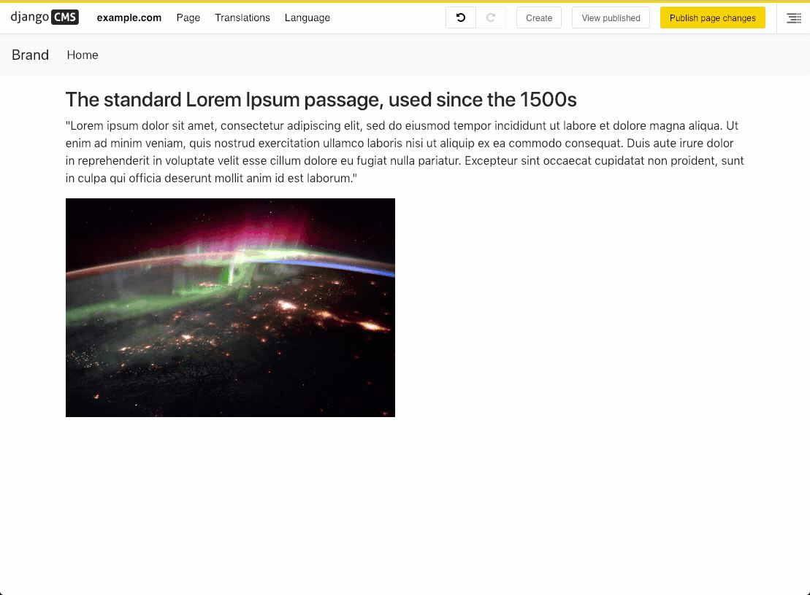

===================
django CMS Transfer
===================

|pypi| |coverage| |python| |django| |djangocms|

**django CMS Transfer** is an **experimental** package that allows you to export
and import plugin data from a page or a placeholder. It does not support foreign
key relations and won't import/export related data, such as `media <https://github.com/django-cms/djangocms-transfer/issues/18>`_.

.. note::

        This project is endorsed by the `django CMS Association <https://www.django-cms.org/en/about-us/>`_.
        That means that it is officially accepted by the dCA as being in line with our roadmap vision and development/plugin policy.
        Join us on `Slack <https://www.django-cms.org/slack/>`_.

Documentation
=============

The setting ``DJANGO_CMS_TRANSFER_SERIALIZER`` allows registration of a custom JSON serializer. An example use case would be subclassing Django's built-in Python serializer to base64-encode inline image data.

See ``REQUIREMENTS`` in the `setup.py <https://github.com/divio/djangocms-transfer/blob/master/setup.py>`_
file for additional dependencies:

Installation
------------

For a manual install:

* run ``pip install djangocms-transfer``
* add ``djangocms_transfer`` to your ``INSTALLED_APPS``

Version Compatibility
---------------------

This version supports django CMS 4.1 and later.

How to Use
----------

To export/import a page, click on the "*Page*" menu on the toolbar
and select your desired choice.

To export/import a plugin, Open the "*Structure board*", click on the
dropdown menu for the specific plugin and select your choice.

Transfer format
---------------

File and browser clipboard exports use the same versioned JSON object::

    {"format": "djangocms-transfer", "version": 1, "kind": "plugin", "plugins": [...]}

``kind`` is ``plugin``, ``placeholder``, or ``page``. Page exports contain
``placeholders`` instead of ``plugins``; each entry has ``placeholder`` (the slot
name) and ``plugins``. File imports into a page preserve these slot names.
Page exports imported into the browser clipboard combine all slots into a single
clipboard placeholder, ready for the normal Paste action.

Both import paths also recognize legacy JSON lists. Lists of plugin records are
treated as a plugin tree when there is one root, or as a placeholder otherwise;
a legacy single-root placeholder cannot be distinguished from a plugin export.
Lists of ``{"placeholder": ..., "plugins": [...]}`` records are treated as page
exports. Export-hook ``null`` plugin rows are skipped. Mixed or malformed records
are rejected, and an unsupported explicit format/version never falls back to
legacy detection. Empty legacy lists are accepted as empty placeholder file
imports; empty content cannot replace the browser clipboard.

Browser clipboard
-----------------

In edit mode, copying or cutting a plugin (including its children), or copying a whole placeholder,
also writes its transfer JSON to the browser clipboard. To transfer it to another
instance, open that instance's administration menu in the toolbar and choose
"Import clipboard from browser…". This replaces your django CMS clipboard;
use the normal Paste action to insert the content wherever it is allowed.

Clipboard content is validated on import, including installed plugin types and
your permission to add them. Invalid content leaves your CMS clipboard unchanged.
File and clipboard imports both call the plugin model's ``full_clean()`` before
saving. Validation and normalization of plugin data, including JSON configuration,
belong in model fields, their validators, or ``Model.clean()``. Plugin editing
forms are not used during import. CMS identity and tree fields are supplied by
the destination and excluded from field validation.
Rich-text sanitization follows the plugin's own save behavior, just as when
editing that plugin normally; this package does not impose a separate HTML policy.
Export-hook ``None`` rows are skipped by both import paths.
Both instances need django CMS Transfer installed. Related objects and media
have the same limitations as file export/import.

Browser clipboard access requires HTTPS (or localhost) and browser permission.
If the browser clipboard cannot be updated, the normal CMS copy still succeeds
and a message explains that browser copying failed.

Customization
-------------

Following settings are available:

* **DJANGOCMS_TRANSFER_MODE** (default: ``"all"``):

  * ``"all"`` enables file export/import and browser clipboard support.
  * ``"files-only"`` disables browser clipboard copying and importing, including
    its toolbar menu item and endpoint. File export/import remains available.
  * ``"clipboard-only"`` enables browser clipboard support and removes file
    import/export menus for pages, placeholders, and plugins.

  Normal django CMS copy/paste remains available in all modes. This setting
  replaces ``DJANGOCMS_TRANSFER_BROWSER_CLIPBOARD``; replace the former value
  ``False`` with ``DJANGOCMS_TRANSFER_MODE = "files-only"``.

* **DJANGOCMS_TRANSFER_MAX_CLIPBOARD_SIZE** (default: ``20971520``, 20 MiB):

  Maximum size of a browser clipboard upload in bytes; ``None`` disables this
  limit. Browser imports use multipart file uploads, so they can exceed Django's
  ``DATA_UPLOAD_MAX_MEMORY_SIZE`` JSON-body limit. Oversized uploads report an
  error and preserve the CMS clipboard. File import remains available for larger
  transfers, subject to the site's web-server limits.

* **DJANGOCMS_TRANSFER_PROCESS_EXPORT_PLUGIN_DATA**:

  Enables processing of plugin instances prior to serialization, e.g.
  ``myapp.module.function``.

* **DJANGOCMS_TRANSFER_PROCESS_IMPORT_PLUGIN_DATA**:

  Enables processing of plugin instances prior to saving, e.g.
  ``myapp.module.function``.
  For example: set default-values for ForeignKeys (images for django_filer, ..)

As an example the combination of ``_PROCESS_EXPORT_PLUGIN_DATA`` and
``_PROCESS_IMPORT_PLUGIN_DATA`` lets you export and import the data between
different systems while setting the contents as you need it::

    # settings.py
    .._PROCESS_EXPORT_PLUGIN_DATA = "myapp.some.module.export_function"
    .._PROCESS_IMPORT_PLUGIN_DATA = "myapp.some.module.import_function"

    # custom functions
    def export_function(plugin, plugin_data):
        # remove child-plugins which can't be handled
        if plugin.parent_id and plugin.parent.plugin_type == "SomeParentPlugin":
            return None
        # change data
        if plugin.plugin_type == "SomePlugin":
            plugin_data["data"].update({
                "some_field": "TODO: change me",
            })
        return plugin_data

    def import_function(plugin, plugin_data):
        some_related_fallback_object = MyModel.objects.first()
        for field in plugin._meta.fields:
            # example of setting a default value for a related field
            if isinstance(field, ForeignKey):
                plugin_value = getattr(plugin, field.attname)
                raw_value = plugin_data[field.name]
                if (
                    field.related_model == MyModel
                    # related object is referenced, but does not exist
                    and plugin_value is None and raw_value is not None
                ):
                    setattr(plugin, field.name, some_related_fallback_object)
        # There is no guarantee on whether djangocms-transfer saves the
        # plugin. It is recommended to do this yourself in case you changed
        # the plugin.
        plugin.save()

Running Tests
-------------

You can run tests by executing::

    python -m venv env
    source env/bin/activate
    pip install -r tests/requirements/dj51_cms41.txt
    coverage run -m pytest

*******************************************
Contribute to this project and win rewards
*******************************************

Because this is an open-source project, we welcome everyone to
`get involved in the project <https://www.django-cms.org/en/contribute/>`_ and
`receive a reward <https://www.django-cms.org/en/bounty-program/>`_ for their contribution.
Become part of a fantastic community and help us make django CMS the best CMS in the world.

We'll be delighted to receive your
feedback in the form of issues and pull requests. Before submitting your
pull request, please review our `contribution guidelines
<http://docs.django-cms.org/en/latest/contributing/index.html>`_.

We're grateful to all contributors who have helped create and maintain this package.
Contributors are listed at the `contributors <https://github.com/django-cms/djangocms-transfer/graphs/contributors>`_
section.

.. |pypi| image:: https://img.shields.io/pypi/v/djangocms-transfer.svg
    :target: https://pypi.org/
.. |coverage| image:: https://codecov.io/gh/django-cms/djangocms-transfer/branch/master/graph/badge.svg
    :target: https://codecov.io/gh/django-cms/djangocms-transfer    
.. |python| image:: https://img.shields.io/pypi/pyversions/djangocms-transfer.svg
    :target: https://www.python.org/ 
.. |django| image:: https://img.shields.io/pypi/frameworkversions/django/django-cms.svg
    :target: https://www.djangoproject.com/
.. |djangocms| image:: https://img.shields.io/pypi/frameworkversions/django-cms/djangocms-transfer.svg
    :target: https://www.django-cms.org/
